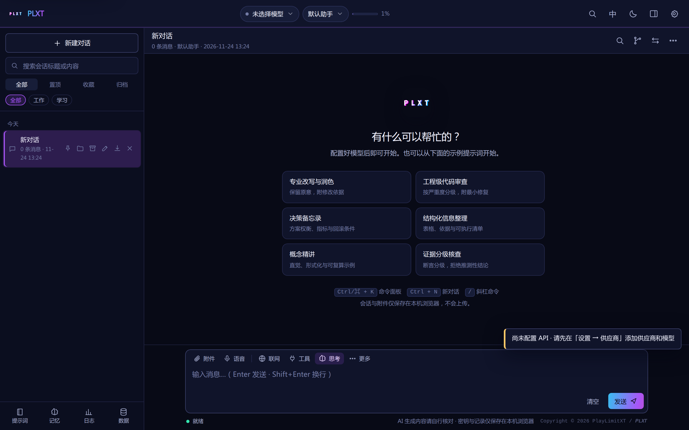
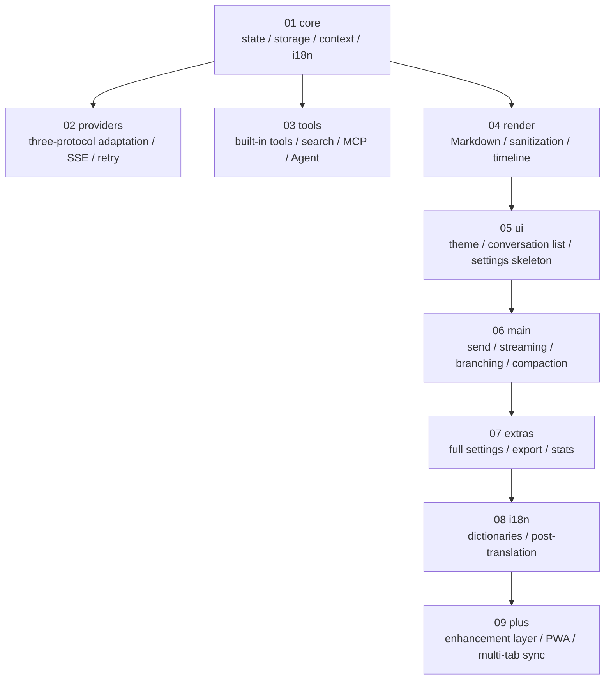
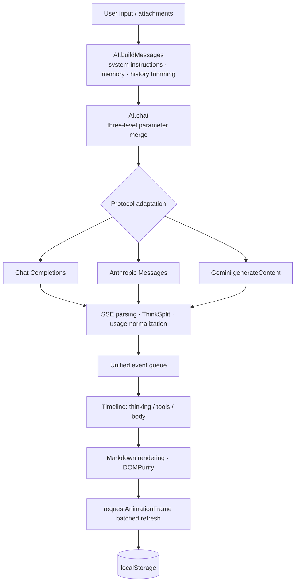

# Building a Local-First AI Workbench with 9 Vanilla JS Files

> **PLXT AI Agent Technical Retrospective**: Zero build, three-protocol adaptation, message tree, streaming timeline, and offline shell
>
> 2026-11-24 · Approx. 18 min read · Version 3.3.0
>
> **Live demo**: <https://playlimitxt.github.io/Project/AI/index.html>  
> **Open-source repository**: <https://github.com/PlayLimitXT/AI-Agent-Web>  
> **License**: MIT

---



## TL;DR

PLXT AI Agent is an AI chat workbench that runs entirely in the browser:

- No backend, no accounts, no telemetry;
- No bundler, framework, TypeScript, or runtime dependencies;
- 9 classic scripts mounted on `window.AI`, loaded in numbered order;
- Supports three protocols: Chat Completions compatible, Anthropic Messages, and Gemini generateContent;
- Conversations are trees, not linear arrays;
- Core Markdown and sanitization libraries are built in; optional enhancement libraries load on demand from a CDN;
- A Service Worker handles the offline shell, but updates must be confirmed by the user.

This article does not restate the feature list; instead, it unpacks several key decisions: why choose zero build, how requests pass through the streaming pipeline, how the message tree works, why the enhancement layer became architectural debt, and how I would change things if I started over.

## 1. Why write yet another chat frontend

AI chat products on the market usually put three things on the server: conversations, keys, and context. For most people this is convenient; for others it is an unacceptable boundary.

The starting point for building PLXT AI Agent was four very specific requirements:

1. **Model requests go directly from the browser to the provider**, without passing through my server.
2. **Conversations and API Keys exist only on the local machine**, and can be exported, audited, and completely deleted.
3. **Parameter control must be complete**, rather than exposing only a temperature slider.
4. **Deployment must be simple enough**: it can run from a static directory, and the app shell can still open offline.

Non-goals are equally clear: no team collaboration, cloud sync, server-side vector retrieval, background tasks, or cross-device real-time state. A pure frontend cannot do these; forcing it would only produce a “pure frontend” that needs a backend.

This boundary determined almost all subsequent technical choices.

## 2. Zero build does not remove engineering; it swaps one set of constraints for another

The PLXT AI Agent runtime is only HTML, CSS, and vanilla JavaScript. Under `js/` there are 9 files, all IIFEs, sharing one global namespace:

```js
(function () {
  'use strict';
  const AI = (window.AI = window.AI || {});
  // ...
})();
```

Scripts are loaded in numbered order in `index.html` as classic `defer` scripts:

```html
<script defer src="js/01-core.js"></script>
<script defer src="js/02-providers.js"></script>
<!-- ... -->
<script defer src="js/09-plus.js"></script>
```

The code deliberately stays at conservative ES2017: no ESM, optional chaining `?.`, nullish coalescing `??`, TypeScript, or frameworks. This buys:

| Benefit | Cost |
| --- | --- |
| Deploy directly on any static hosting | No tree-shaking; all 9 files load in full |
| `file://` double-click works | No module boundaries; rely only on naming conventions |
| Debug directly in the browser, no source maps | No type checking; refactoring relies on search and self-checks |
| Small supply chain; core libraries built in locally | Large files are hard to unit test; 25–124 KB per file |
| No `npm install` required to run | Engineering constraints must be enforced by scripts |

Having no build step does not mean abandoning engineering discipline. The repository contains a zero-dependency `scripts/check.mjs` that locks down constraints that “people easily forget but machines can verify”: syntax, file existence, version numbers in four places, script order, Service Worker cache manifest, documentation links, CSP, sanitization chain, license, and debug leftovers. Currently there are 34 checks.

```bash
npm run check
# PLXT AI Agent check: 34 checks passed.
```

It cannot replace browser testing, but it blocks the vast majority of low-level mistakes that would otherwise be discovered only after committing.

## 3. How the nine files divide responsibilities



| File | Responsibility |
| --- | --- |
| `01-core.js` | Global namespace, state model, storage and migration, conversation tree, parameter parsing, context construction |
| `02-providers.js` | Three-protocol adapters, SSE parsing, `think` splitting, `usage` normalization, retry and timeout |
| `03-tools.js` | Built-in tools, MCP client, web search, multi-turn Agent loop |
| `04-render.js` | Message rendering, timeline, Markdown sanitization, code blocks, collapsible areas |
| `05-ui.js` | Theme, conversation list, settings page skeleton, command palette, attachments, scroll following |
| `06-main.js` | Send / generate / stop / continue, branching and comparison, compaction, initialization |
| `07-extras.js` | Full settings page, parameter panel, export formats, stats page, extension actions |
| `08-i18n.js` | Chinese-English dictionaries, regex rules, DOM post-translation and MutationObserver |
| `09-plus.js` | Brand filling, model metadata inference, error boundary, PWA, multi-tab sync |

### Enhancement layer: fastest way to extend, and largest architectural debt

`07-extras.js` and `09-plus.js` are not merely “adding features”. They wrap or override functions with the same names from earlier modules, for example:

```js
const origRenderDrawer = U.renderDrawer;
U.renderDrawer = function () {
  origRenderDrawer.call(U);
  // append enhancement logic
};
```

`09-plus.js` wraps functions such as `AI.load`, `U.toggleLang`, `U.renderAll`, `U.applyTheme`, `U.drawerAction`, `U.renderMessages`, and `U.modal`; some chains reach three levels deep.

Benefit: capabilities can be stacked quickly without changing old files, and the upgrade path is short.

Drawback: when calling a function, what you see is not necessarily the final implementation; breakpoints pass through multiple wrapper layers; an incorrect modification order can produce behavior differences that are hard to locate.

This is the clearest technical debt in the current architecture. If the next version continues to evolve, I will split `05-ui.js` into smaller responsibility modules and introduce explicit extension points, rather than continuing to deepen the same-name function wrapper chain.

## 4. How a request passes through the system



The really troublesome part of this pipeline is not “sending the request”, but the following things.

### 4.1 Context is not simple concatenation

`AI.buildMessages(conv, opts)` is responsible for converting the internal message tree into the message array required by the target protocol. It must handle:

- Where system instructions go: `system`, user prefix, or not sent;
- Injection order for long-term memory, retrieval context, and worldbook;
- History trimming by message count or token budget;
- Strategies such as “keep first and last” and “do not trim”;
- Requirements of different protocols for roles and content blocks.

Tokens before a request can only be estimated by characters, because the server does not provide an exact count before the request. Actual usage is based on the `usage` in the response.

### 4.2 Three protocols, one call entry point

`AI.chat()` selects an adapter based on provider type and merges global, conversation, and model-level parameters. The streaming event shapes of the three protocols are completely different:

- Chat Completions: `data: {...}` and `[DONE]`;
- Anthropic: `message_start`, `content_block_delta`, `message_stop`;
- Gemini: incremental JSON from `alt=sse`.

The adapters converge the differences into a unified result, then hand it to `sseEvents()` for event-by-event parsing.

### 4.3 Thinking content must be split incrementally

Some models put the thinking process in the body, wrapped in `think` tags. `ThinkSplit`’s job is incremental splitting, not waiting until the stream ends and then doing regex replacement:

```js
const splitter = new ThinkSplit();
// For each incremental chunk:
splitter.feed(chunk);
// At stream end:
splitter.finish();
```

This is the only way to preserve the true arrival order between thinking and body, rather than moving the entire thinking block to the front.

### 4.4 The timeline is not string concatenation

An assistant reply may contain:

1. a segment of thinking;
2. a tool call;
3. a tool result;
4. another segment of thinking;
5. the body;
6. another tool call.

If only a single `content` string is maintained, the order of these events is lost. PLXT AI Agent uses a unified event queue to write thinking, tools, and body into the timeline in arrival order; ordinary replies return to single-block rendering at the end to save storage space.

### 4.5 Rendering must be batched; do not re-layout per token

Triggering a DOM update for every token during streaming will quickly bog down long conversations. `06-main.js` uses `requestAnimationFrame` to merge refreshes, and Markdown rendering throttles adaptively based on content length. When the user scrolls up, the system detaches from automatic following, avoiding “being pulled back to the bottom just after scrolling up”.

### 4.6 Termination signals and abnormal endings

Different protocols end in different ways: `[DONE]`, `finish_reason`, `message_stop`, or a `usage` settlement. Adapters must distinguish “normal completion” from “connection closed early”. The latter must not be silently treated as an empty reply; instead, show a prompt and offer “continue generating”.

Timeouts and user-initiated stops are merged into the same `AbortSignal`; `429`, `5xx`, and network errors are retried with exponential backoff.

### 4.7 usage normalization

Real billing cannot rely on guessing. `findUsage()` and `mergeUsage()` normalize fields from different protocols into:

```js
{ in, out, total, cached, reasoning, source }
```

As long as the API returns real values, they take priority; only when missing are local estimates used, and they are clearly marked. Costs are still estimated using local unit prices and do not represent provider bills.

## 5. Message tree: why not a linear array

A linear array suits “one question, one answer” but not branched conversations. A PLXT AI Agent conversation is a node table:

```js
{
  nodes: {
    root: { id: 'root', parentId: null, children: [], activeChildId: null },
    n1:   { id: 'n1', parentId: 'root', children: ['n2', 'n3'] },
    n2:   { id: 'n2', parentId: 'n1', children: [] },
    n3:   { id: 'n3', parentId: 'n1', children: [] }
  },
  rootId: 'root'
}
```

Key fields:

- `parentId`: trace context backward;
- `children`: multiple versions under the same node;
- `activeChildId`: the currently selected branch.

From this, the following can be implemented naturally:

- Regenerate → add a sibling node;
- Edit and re-answer → derive a new branch from the edited node;
- Generate with another model → add a model branch under the same parent;
- Derive conversation → copy the path from any node;
- Branch tree view → traverse `children`.

### Local state and migration

| Key | Content |
| --- | --- |
| `ai-chat-pro-v3` | Conversation tree, settings, providers, logs, stats |
| `ai-chat-pro-v3-secrets` | Sensitive fields that can be stored separately |
| `plxt-ai-chat-v3` | Legacy migration source |

API Key supports three storage modes:

- `localStorage`: retained after refresh and reopening the browser;
- `sessionStorage`: invalidated after closing the tab;
- Memory only: invalidated on refresh.

Storage write failures (e.g., insufficient quota) will be reported but will not interrupt the conversation. Multiple tabs sync via the `storage` event; merge capability during generation is limited, so generating for the same conversation in two tabs at the same time is not recommended.

### Why not IndexedDB yet

IndexedDB is better suited for large capacity, sharding, and structured queries. But the current implementation chooses `localStorage` because:

- The data structure is simple; the whole tree is read and written at once;
- Debugging is intuitive; it can be viewed directly in the browser;
- Migration and export logic are simpler.

The cost is capacity limits and main-thread serialization overhead. As conversation scale continues to grow, IndexedDB sharding will enter the next version’s list.

## 6. Streaming rendering and security

Model output is untrusted content. All Markdown in PLXT AI Agent goes through `AI.Render.sanitize`, backed by built-in DOMPurify with custom hooks:

- Remove inline styles to prevent model output from forging a `position: fixed` interface;
- Remove dangerous nodes such as `iframe` and `form`;
- Image `src` only allows `http(s)`, `data:image`, and `blob:`, avoiding invalid same-origin requests;
- Force external links to use `noopener noreferrer`.

During streaming, there is also a contradiction to handle: Markdown needs complete syntax to parse correctly, but tokens arrive incrementally. The implementation uses a strategy of “adaptive throttling by length + final full re-render”: prioritize responsiveness during streaming, then do one stable render at the end.

Thinking areas and tool results are collapsed by default; the header shows activity counts and can be expanded by click or keyboard. This preserves audit information without letting long thinking drown out the body.

## 7. Three protocols and the tool loop

### 7.1 Adapter boundaries

When adding a new protocol, three places need changes:

1. The branch in `AI.chat()`;
2. Conversion of tool definitions to the target protocol format;
3. Parsing the model list in `AI.fetchModels()`.

Parameter merging follows the priority “global → conversation → model”. For `o` series, `gpt-5`, and reasoning models, incompatible sampling parameters are automatically omitted to avoid request failure.

### 7.2 Tools and MCP

Built-in tools include time, calculation, JSON value access, text statistics, encoding/decoding, unit conversion, etc. Web search and MCP use the same tool-calling interface:

- MCP uses Streamable HTTP and JSON-RPC 2.0;
- Supports session ID negotiation, tool discovery, and invocation;
- Tool results and thinking are written into the timeline in true order;
- Tool approval and blacklists can restrict high-risk operations.

The Agent loop defaults to 6 rounds and maxes out at 12 rounds; when the limit is reached, it is clearly marked rather than silently stopped.

### 7.3 CORS is a hard boundary for pure frontend

All requests are sent by the browser, so they must comply with the target service’s CORS policy. This is not an implementation defect, but a physical boundary of pure frontend.

If the provider does not allow cross-origin requests, the only clean solution is a same-origin reverse proxy:

```nginx
location /provider/ {
    proxy_pass https://api.example.com/;
    proxy_buffering off;
    proxy_read_timeout 3600s;
}
```

Then change the Base URL in the provider settings to the same-origin path. For specific configuration and security considerations, see [DEPLOY.md](../../DEPLOY.md) in the repository.

## 8. Offline and updates

`sw.js` uses a hybrid strategy:

| Request type | Strategy |
| --- | --- |
| Navigation requests | network-first, fall back to cache or `offline.html` on failure |
| Same-origin static assets | cache-first + background refresh |
| Whitelisted CDN static libraries | network-first, write to cache on success |
| Other cross-origin requests | do not intercept, go directly to network |

The app shell is precached via the `SHELL` list: entry, styles, 9 scripts, manifest, logo, offline page, and `vendor/` first-screen dependencies.

### Why updates do not take effect automatically

The install phase deliberately **does not call** `skipWaiting()`. If a new version forcibly takes over while the user is in a conversation, a state where “half the page is old and half is new” may occur, and content being streamed may even be lost.

The current flow is: new SW installed → page prompts “new version found” → user confirms → page sends `SKIP_WAITING` → new version takes over.

### Why there are four version numbers

The runtime version must be consistent, otherwise cache and documentation will contradict each other:

1. `index.html` → `window.PLXT_BRAND.version`
2. `sw.js` → `VERSION`
3. `manifest.json` → `version`
4. `package.json` → `version`

`npm run check` verifies that all four are exactly the same. Any runtime JS / CSS change should bump the version and be recorded in `CHANGELOG.md`.

### Subpath deployment

All resources use relative paths, and the `start_url` and `scope` in `manifest.json` are also relative values, so it can be deployed directly under subpaths like `https://example.com/Project/AI/`. The current Demo is deployed this way.

`file://` is also supported, but no Service Worker is registered, and there is no PWA installation or offline cache.

## 9. Security and privacy boundaries

The privacy model of PLXT AI Agent can be compressed into one sentence: **business data does not leave the browser unless you actively send it to a provider.**

Specifically:

- No self-hosted backend, account system, or cloud sync;
- The page contains no analytics or telemetry scripts; the first screen requests only same-origin resources;
- Model, search, and MCP requests are sent directly to user-configured endpoints;
- Core `marked` and `DOMPurify` are built into `vendor/`;
- Optional enhancement libraries load from a fixed CDN on demand and can be placed in `vendor/` for full offline use.

CSP restricts script and style sources via `meta`, including `object-src 'none'` and `base-uri 'self'`. For production, it is recommended to use the HTTP response header version to supplement directives that `meta` cannot express, such as `frame-ancestors` and HSTS.

Boundaries that need honest explanation:

- `connect-src` is currently broad because users may configure arbitrary providers; it can be tightened for fixed deployments.
- Browser extensions, malware, and already-compromised devices are outside the defense scope.
- The logging policies of providers, search vendors, and MCP servers are not controlled by this project.
- Local unit-price estimates are not equivalent to provider bills.

## 10. How to keep the repository maintainable without a test framework

This is a pure frontend single-page application, with core logic strongly coupled to the DOM. Directly introducing a unit testing framework would require a round of modular refactoring first, with costs higher than current benefits. So I chose two layers of verification:

**Layer one: static contract checks**

`npm run check` covers 34 items, including:

- Syntax of all JS / MJS;
- Whether required files exist;
- Whether the four version numbers are consistent;
- Whether `index.html` loads all modules in numbered order;
- Whether the Service Worker `SHELL` covers the app shell;
- Whether manifest icons exist;
- Whether Markdown local links resolve;
- Whether CSP retains `object-src 'none'` and `base-uri 'self'`;
- Whether model HTML passes through DOMPurify;
- Whether `debugger` / `console.log` leftovers remain;
- License and npm publish boundaries.

I also did a negative verification: deliberately changed the version number in `sw.js` to `0.0.1`, checked that the script failed with exit code 1, and accurately pointed out the differences at four locations.

**Layer two: manual regression matrix**

Before committing, at minimum cover:

- One streaming conversation for each of the three protocols;
- Stop and continue generation;
- Tool calls and a two-round Agent;
- Chinese-English switching;
- Export and import;
- Service Worker and offline page under HTTP deployment;
- Direct opening via `file://`.

**Layer three: CI**

GitHub Actions runs `npm run check` on Node 20 and 22. There is no `npm install` and no build step; CI time is mainly spent on checkout and Node startup.

This scheme cannot prove the UI is not broken, but it can prove that the repository does not violate its own declared constraints.

## 11. If I started over

If I wrote it again from scratch, I would keep these decisions:

- Pure static, zero build, browser direct connection;
- Message tree rather than linear array;
- Unified event queue rather than string concatenation;
- Core libraries built in locally, optional libraries loaded on demand;
- Service Worker updates confirmed by the user.

I would change these:

1. **Tear down the enhancement-layer wrapper chain**. Split `05-ui.js` into modules for conversation list, settings, editor, scrolling, etc., and use explicit hooks instead of same-name function overrides.
2. **Introduce JSDoc or gradual typing**. Zero build does not mean zero types; at least add annotated types for the state model and adapter interfaces.
3. **Add Playwright smoke tests**. Cover send, stop, continue, branch switching, export, and offline shell, without needing to cover every UI detail.
4. **Do storage sharding earlier**. Migrate large conversations to IndexedDB, keeping only indexes and settings in `localStorage`.
5. **True incremental DOM diff**. The current rAF batched refresh solves most problems, but long conversations still have room for optimization.
6. **Multi-tab generation merging**. Currently only state sync is done; concurrent generation for the same conversation can still conflict.
7. **Add MCP SSE GET and `n>1` multiple candidates**. These are structural capabilities, not UI patches.
8. **Structured schema versioning**. Currently it relies on field compatibility and migration functions; explicit schema versions would make upgrades more controllable.

These are not “roadmap promises”; they are simply the real boundaries exposed by this implementation.

## 12. Running and deployment

Local preview:

```bash
# In the repository root, Node 18+
npm run serve
# → http://127.0.0.1:8080/
```

Self-check before committing:

```bash
npm run check
```

Deployment only requires placing the directory on any static hosting:

- Nginx / Apache / GitHub Pages / Netlify / Vercel / Cloudflare Pages;
- Subpath deployment requires no code changes;
- HTTPS is a prerequisite for Service Worker and PWA;
- If the provider does not support CORS, configure a same-origin reverse proxy according to [DEPLOY.md](../../DEPLOY.md).

For more usage paths, see [Usage Instructions](../USAGE.md); for the security model, see [SECURITY.md](../../SECURITY.md); for contributing, see [CONTRIBUTING.md](../../CONTRIBUTING.md).

## Conclusion

“Local-first” is not a slogan, but a set of constraints: state cannot be put on the server, background tasks cannot be relied on, the network cannot be assumed to be always available, and “the cloud computes it for you” cannot be used to mask browser boundaries.

These constraints make some features impossible, but they also make other things simple: deployment is a directory, data is an exportable JSON, keys are in the user’s own hands, and the app can still open offline.

If you are also building a similar pure-frontend AI tool, I hope this retrospective helps you avoid a few pitfalls. Issues, real provider integration results, or direct PRs are welcome in the repository.

- **Demo**: <https://playlimitxt.github.io/Project/AI/index.html>
- **GitHub**: <https://github.com/PlayLimitXT/AI-Agent-Web>
- **License**: MIT