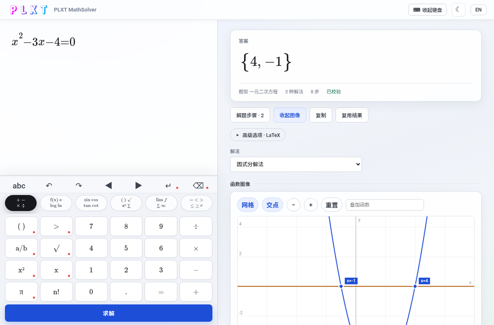
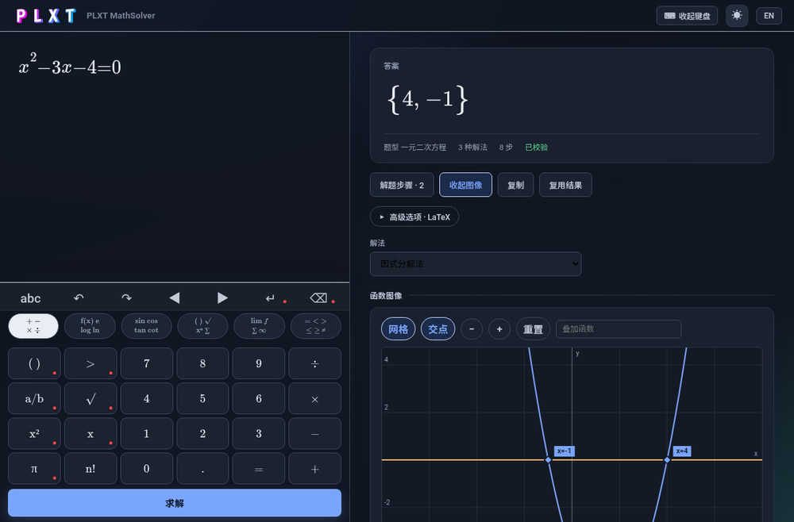
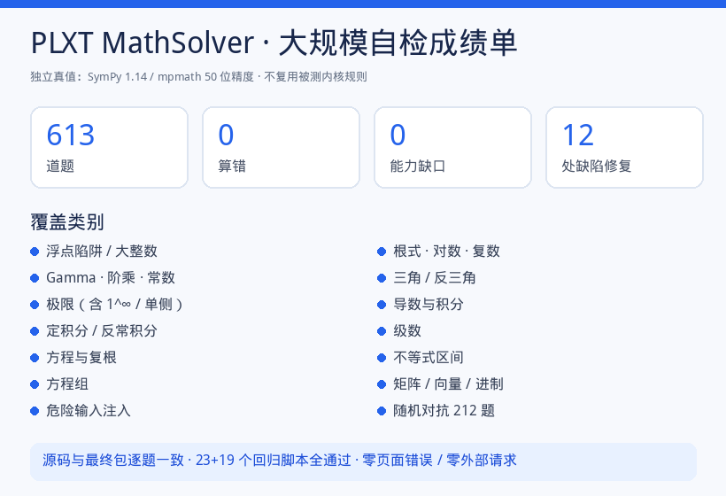
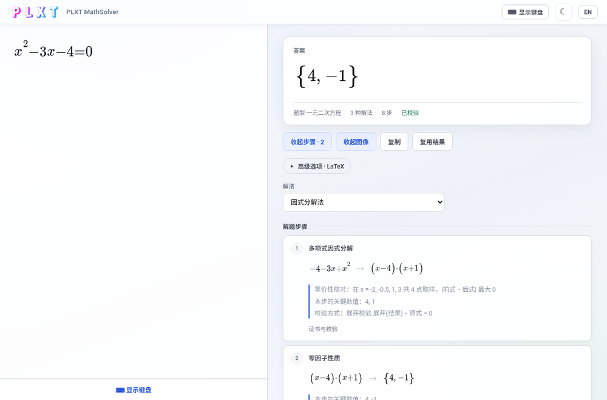
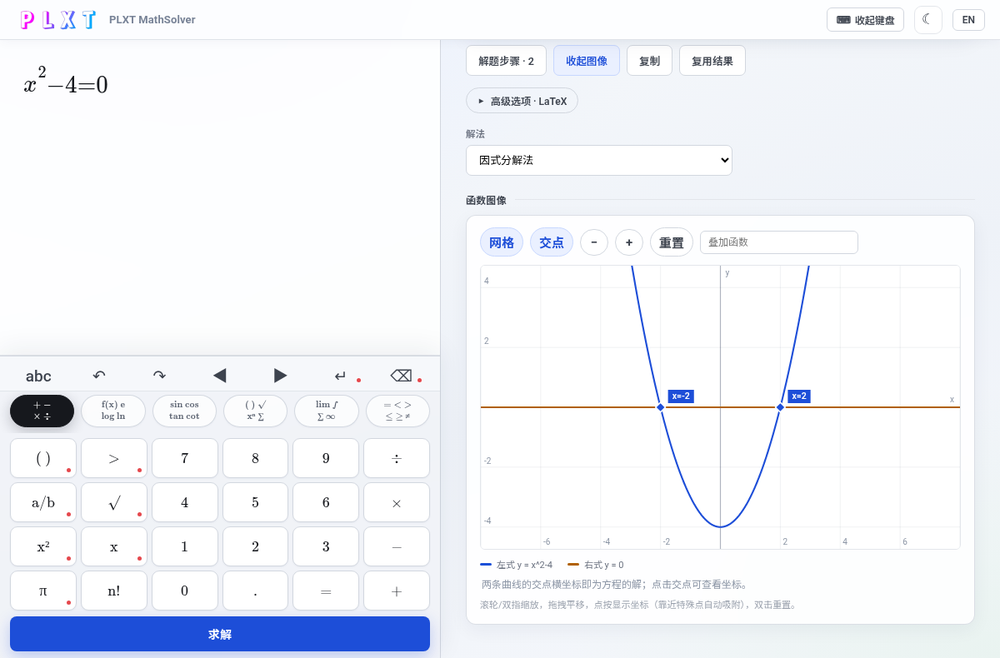
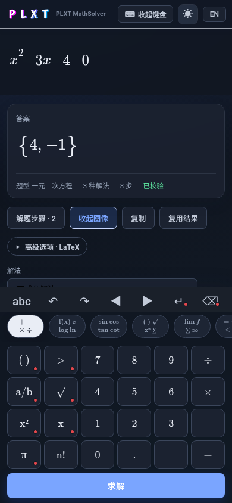

- title: "Building PLXT MathSolver: an offline, exact, and verifiable math engine in plain JavaScript"
- date: 2026-11-28
- author: PlayLimitXT
- description: "A detailed engineering write-up of a zero-dependency, fully offline structured math editor and solver: box-tree input, certified derivations, exact arithmetic, an independent 613-case oracle, and the repository discipline behind a release-ready static app."
- tags: [javascript, computer-algebra, katex, mathjs, offline-first, testing, devtools]
- canonical: https://PLXT.pages.dev/
- license: MIT

---

# Building PLXT MathSolver: an offline, exact, and verifiable math engine in plain JavaScript

> **TL;DR** — PLXT MathSolver is a static web application that opens from `file://`, ships 42 runtime files and 20 local fonts, makes zero network requests, and returns exact answers with derivation steps that carry their own checkable evidence. There is no build step, no server, no runtime dependency, no camera, and no generative model in the loop. This post walks through the design decisions, the parts that were genuinely hard, the twelve real defects a 613-case independent oracle exposed, and the engineering discipline that turned a prototype into something I was willing to publish.

| | |
|---|---|
| **Live app** | [plxt.pages.dev/Project/PLXT-MathSolver](https://plxt.pages.dev/Project/PLXT-MathSolver/) · [GitHub Pages mirror](https://playlimitxt.github.io/Project/PLXT-MathSolver/) |
| **Author site** | [PLXT.pages.dev](https://PLXT.pages.dev/) · [mirror](https://playlimitxt.github.io/) |
| **Source** | [github.com/PlayLimitXT/PLXT-MathSolver](https://github.com/PlayLimitXT/PLXT-MathSolver) |
| **Licence** | [MIT](https://github.com/PlayLimitXT/PLXT-MathSolver/blob/master/LICENSE) — also the `LICENSE` file at the repository root (project code); vendored math.js is Apache-2.0, vendored KaTeX is MIT |



*Figure 1 — The desktop layout. On a landscape viewport the editor and keypad occupy the left column and the results scroll independently on the right. On a portrait viewport the keypad is pinned to the bottom and only the result region scrolls.*

## Contents

1. [Why another math solver](#1-why-another-math-solver)
2. [Five constraints that shaped everything](#2-five-constraints-that-shaped-everything)
3. [Architecture at a glance](#3-architecture-at-a-glance)
4. [The editor is a tree, not a string](#4-the-editor-is-a-tree-not-a-string)
5. [The certified kernel](#5-the-certified-kernel)
6. [Exactness engineering](#6-exactness-engineering)
7. [Honest steps](#7-honest-steps)
8. [Rendering and graphing](#8-rendering-and-graphing)
9. [Verification against an independent oracle](#9-verification-against-an-independent-oracle)
10. [Performance work](#10-performance-work)
11. [Security, privacy and accessibility](#11-security-privacy-and-accessibility)
12. [Internationalisation and a fixed brand](#12-internationalisation-and-a-fixed-brand)
13. [Repository engineering](#13-repository-engineering)
14. [Deployment](#14-deployment)
15. [Known limitations](#15-known-limitations)
16. [What I would build next](#16-what-i-would-build-next)
17. [Closing](#17-closing)

---

## 1. Why another math solver

The category is crowded, but most of the well-known products are built around a camera. You photograph a problem, a recognition model guesses the expression, a search layer or a symbolic engine produces an answer, and the UI renders a tidy chain of steps. That pipeline works remarkably well for printed homework, and it has two properties I did not want: it needs a network, and the step list is often a presentation artifact rather than a record of what the engine actually did.

I wanted something narrower and more defensible. The input should be **structured**: you build a fraction by inserting a fraction template, you build a radical by inserting a radical template, and every blank is an explicit hole. The output should be **exact**: `√8` becomes `2√2`, `100!` keeps all 158 of its digits, and `x³−1=0` returns all three roots including the complex pair. And the derivation should be **auditable**: if the UI says a step is verified, there should be a numeric or symbolic check attached to it, not just prose.

That last requirement turned out to be the most useful design constraint in the whole project. It forced me to distinguish three things that are easy to conflate: the answer, the human-readable derivation, and the machine work that found the answer. Once those are separate objects, a lot of other decisions become obvious.

A secondary motivation was portability. A static page that runs from the file system is trivial to archive, trivially private, and trivially deployable to any static host. No accounts, no telemetry, no backend to maintain. The entire product is the repository.

---

## 2. Five constraints that shaped everything

1. **Zero network at runtime.** Every script, stylesheet, font and image is local. The only allowed URI in shipped SVG is the W3C namespace `http://www.w3.org/2000/svg`, which is an identifier, not a fetch ([W3C SVG specification](https://www.w3.org/TR/SVG/)).
2. **Zero runtime dependencies.** [math.js 3.29.1](https://mathjs.org/) and [KaTeX 0.16.11](https://katex.org/) are vendored, unmodified, with their licence texts in `LICENSES/`. `package.json` has an empty `dependencies` object; Playwright is dev-only.
3. **Exactness before decimals.** A decimal companion is attached when it is genuinely informative, never substituted for a closed form.
4. **No unverified output.** A step without a certificate is not shown. A machine search procedure is flagged and hidden. A topic the kernel cannot handle says so explicitly instead of guessing.
5. **A fixed identity.** The name and the wordmark are hard-coded, not configurable, and do not change with theme or language.

Constraint 4 has a corollary that took a while to accept: **an unsolved expression and an undefined expression are different results**. `log(0)` is `Undefined`; a dangling equals sign is an input problem; a solvable integral outside the recognised table is an honest capability gap. Conflating them produces the worst kind of UX, because the user cannot tell whether the mathematics is broken or the tool is limited.

---

## 3. Architecture at a glance


*Figure 2 — Runtime architecture. Green boxes are verification infrastructure that never ships in the runtime bundle; amber boxes are policy boundaries.*

The load order in `index.html` is deliberate and dependency-ordered:

```
math.js → KaTeX → i18n → model → render → editor → keypad
        → solver → exact → augment → plot → latex → app
```

`solver.js` exposes `PLXT.solver`; `exact.js` wraps `solve()` to substitute closed forms before the general pipeline runs; `augment.js` wraps it again to enrich the result without ever changing the answer. That layering mattered during the final self-test: twelve of the fixes landed in `solver.js` and `exact.js`, while the UI, theme, brand and offline resources were untouched.

| Layer | Files | Responsibility |
|---|---|---|
| Model / editor | `model.js`, `render.js`, `editor.js`, `keypad.js` | Box tree, caret, structured editing, templates |
| Kernel | `solver.js` (~5.3k lines), `augment.js` | Topic dispatch, roots, limits, integrals, steps |
| Exactness | `exact.js` | BigInt, complex, closed forms, radix, decimals |
| Presentation | `app.js`, `plot.js`, `latex.js`, `i18n.js` | State, graph, LaTeX bridge, 166 bilingual keys |
| Vendored | `vendor/mathjs`, `vendor/katex` | Parsing / numerics / typesetting |

The first-party JavaScript is roughly twelve thousand lines across thirteen modules. The repository is 81 files; 42 of them are runtime assets, including 20 `woff2` fonts. The published archive is about 1.8 MB.



*Figure 3 — Dark theme. The wordmark is pixel-identical to the light-theme version; only the interface palette changes.*

---

## 4. The editor is a tree, not a string

The single most consequential decision was to remove the text box entirely. There is no `<input>` for a formula anywhere in the application. A formula is a **box tree**: a fraction node owns a numerator child and a denominator child, a radical owns a radicand, a power owns a base and an exponent, an integral owns upper and lower limits plus an integrand and a differential row, and a matrix owns a grid of cells. Empty children are first-class `hole` nodes rendered as dashed squares.

This buys several things at once:

- **No parsing ambiguity.** `\frac{a+b}{c}` has an explicit denominator scope. There is no "did the user mean `a+b/c`" problem.
- **No recognition step.** A camera-based product has to display "we read this as..." and offer a correction affordance. Here there is nothing to correct: the tree the user built *is* the input.
- **Clickable editing.** Clicking anywhere in the rendered formula maps back to a node. The caret can enter a denominator, walk right out of an exponent, or sit inside a matrix cell.
- **Templates carry intent.** Inserting `d/dx`, `∫`, `lim`, `∑` or a matrix template also sets the operation, so the router does not need to guess what the user wanted.

It also creates a surprising amount of work. Backspace is not "delete the last character"; it has to delete exactly one **visual atom** to the left of the caret. `x²` → `x`, not `x²` → `x` with a dangling exponent box, and certainly not `x²` → `2`. Composite exponents such as `x^(a+b)` must degrade into character-level editing. Empty cells must be marked incomplete so that `[[,2],[3,4]]` never reaches the solver. Clearing a matrix must also reset the residual intent, otherwise the next innocent `2+3` gets routed to matrix inversion. Those were real bugs, found and fixed during review, and they are the tax you pay for a structured editor.

The LaTeX panel is deliberately optional and collapsed by default. It is bidirectional — `toLatex()` and `fromLatex()` round-trip the box tree — and it includes a live preview. Opening it does not focus the textarea, so the on-screen keyboard is not raised until the user actually taps the field.


*Figure 4 — The advanced LaTeX panel. Sources are length-limited, screened for executable markup, rendered with `trust: false`, and screened again on output before the resulting HTML is written to the page.*

---

## 5. The certified kernel

The kernel returns a single result object:

```js
{
  ok: true,
  topic: 'equation',
  answer: '{4, -1}',
  methods: [ /* one or more derivations */ ],
  graph:  { ... },
  summary: { steps: 8, verified: 8 },
  notes: ['exact'],
  detail: '',
  decimal: ''
}
```

Each method contains steps, and each step is a record with provenance rather than a sentence. Abridged:

```js
{
  rule: 'FUNDAMENTAL_THEOREM_OF_CALCULUS',
  before: 'integral(log(x), x, 0, 1)',
  after:  '-1',
  cert:   'oracle',
  payload: {
    verified: true,
    check: 'derivative_equivalent',
    evidence: [
      { k: 'ev.fact',  a: ['one-sided limit of the antiderivative'] },
      { k: 'ev.check', a: ['#endpoint_limit'] }
    ]
  }
}
```

Three details make this more than decoration.

**Evidence is language-neutral.** Templates use `{0}` placeholders, `@RULE` references and `#CHECK` references, and are localised at render time. Adding a language does not require rewriting a single certificate.

**Guards travel with the step.** Dividing by an expression carries a non-zero condition; squaring both sides carries a possible-extraneous-root note; logarithms carry domain conditions. A step that is algebraically pretty but invalid on the domain is not a valid derivation.

**Certificates are checked, not asserted.** A derivative result is validated by sampling `dF/dx`; an equation root is back-substituted; an empty solution set is only marked verified when no candidate was discarded by a domain filter; an interval answer is checked against truth predicates. In the final run, 613 cases produced zero unverified and zero evidence-less steps.

Topics are dispatched rather than solved by one giant simplifier: exact arithmetic, simplification, polynomial roots, general equations, inequalities, limits, derivatives, indefinite and definite integrals, improper integrals, series, systems, matrices, vectors, radix conversion, and undefined-input guards. Free variables are normalised internally so `2t+3=7` and `n²−5n+6=0` behave like their `x` equivalents, then restored in the answer, steps and graph labels.

---

## 6. Exactness engineering

Float arithmetic is the default failure mode of browser-based math. A few representative results, all verified independently:

| Input | Result | Why it is easy to get wrong |
|---|---|---|
| `(10^20 + 1) − 10^20` | `1` | IEEE-754 swallows the `+1` |
| `0.1 + 0.2` | `3/10` | Binary floats give `0.30000000000000004` |
| `100!` | all 158 digits | Naive factorial degrades to scientific notation |
| `√8` | `2√2` | Surd normalisation, not a decimal |
| `log₂(3⁵+7)` | `1 + 3 log₂ 5` | Integer factorisation inside a logarithm |
| `x³−1=0` | `{ 1, −1/2 + √3/2 i, −1/2 − √3/2 i }` | Complex roots are usually dropped |
| `ln(−1)` | `iπ` | Principal branch of the complex logarithm |
| `arccos(cos 5)` | `2π − 5` | Naive implementations echo the input |
| `∫₀¹ log(x) dx` | `−1` | The singularity is at an endpoint |
| `∫₀^∞ e^(−x²) dx` | `√π/2` | Gaussian half-line closed form |
| `∑ (-1)^(n+1)/n` | `log(2)` | Alternating series needs a convergence test |
| `ζ(2)` | `π²/6` | Special-value table |
| `sin(π/12)` | `(√6 − √2)/4` | Exact trig table for rational multiples of π |
| `Γ(1/2) + Γ(3/2)` | `3√π/2` | Half-integer Gamma algebra |

The mechanisms behind these are unglamorous and specific:

- **BigInt rational arithmetic** for pure numeric expressions, with a length guard so long integer literals are rendered as digits rather than coerced through `Number` into `9.33×10^…`.
- **Durand–Kerner** for the complete root set of a polynomial, with every root back-substituted in the complex plane before it is allowed into the answer.
- **Aitken acceleration plus guarded one-sided sampling** for limits, including `1^∞` forms such as `(1 + 1/x)^x → e`; divergent and non-existent limits are reported as such rather than as a number.
- **One-sided limits of the antiderivative** for improper integrals. This is the fix that turned `∫₀¹ log(x)dx` from a wrong `0` into `−1`, and it also repaired the FTC certificate at singular endpoints.
- **Leibniz test plus Euler transformation** for alternating series, and an integral tail estimate for p-series.
- **A symbolic antiderivative first, numeric quadrature second** policy for definite integrals. `∫₀^1000 sin(x) dx` is `1 − cos(1000)`; fixed-step Simpson over a thousand radians would have been both slow and wrong.
- **Domain-aware equivalence checks** when matching integrands, so `sqrt(1−x²)` is only compared where both sides are defined.



*Figure 5 — Verification scorecard. Expected values come from SymPy 1.14 and mpmath at 50 decimal digits, entirely outside the shipped JavaScript kernel.*

---

## 7. Honest steps

This is the part I am most opinionated about. A computer algebra system optimises for a normal form; its internal rewrites are a side effect, not a pedagogy. If you simply log `simplify()` you get a sequence that is technically true and pedagogically useless. Worse, some products pad trivial inputs with decorative steps — I have seen `π + e` expanded into four lines of nothing.

So the rule is blunt: **if there is no genuine derivation, there are no steps.** `π + e`, `x`, `1+1` and `3` return the answer with an empty step list, and the steps button hides itself. When there is a derivation, the result offers multiple methods — a quadratic can be solved by factoring, the quadratic formula, completing the square, or Vieta's relations — each with its own trail.

The inverse problem is machine work. Bracket scans, bisection iterations, sampling plans and multi-start Newton solves are how the engine *finds* roots; they are not how a human should read a solution. Those methods are flagged `machine: true` and filtered out of the visible step list, while the answer, the numerical-solution badge, the residual check and the graph remain. Numerical answers are labelled numerical; a provably complete global root search is labelled complete. Nothing generated by a search is dressed up as a certificate.



*Figure 6 — Steps are rule-based transformations with evidence, certificates and expandable detail. Repeated or regressive steps are removed before rendering.*

---

## 8. Rendering and graphing

Typesetting is a hybrid. Individual leaves — a symbol, a number, an operator — go through KaTeX with `trust: false`, expansion and size limits, and an output guard. Structure — fractions, radicals with a continuous overline, matrix brackets, big-operator limits, systems wrapped in a brace — is built as DOM by `render.js`. That split is why fraction bars can be measured against their widest operand and why `x→∞` sits directly beneath `lim` while integral limits stay in their conventional positions.

Long answers are scaled down until the whole row fits, with a readable floor and horizontal scrolling only as a last resort. All measurements are batched before any font size is written, avoiding one forced synchronous layout per formula.

The graph is a plain canvas, no charting library. Axes share a single scale — `yspan = xspan × height/width` — so circles are circles rather than ellipses, and the vertical centre is chosen without stretching the data range. Equations are drawn as two curves whose intersections are the roots; systems draw multiple curves. Wheel, pinch, `+`/`−`, drag, double-click reset, grid toggle, and point picking with snapping to roots, extrema and intercepts are all implemented directly.

Two rendering bugs worth mentioning because they were instructive: pinch handling was using `clientX/clientY` without subtracting the canvas origin, so a two-finger gesture shifted the y-centre by roughly fifteen units; and the dark-theme plot colours were falling back to light values because of an undefined colour helper. Both were caught by screenshot review, not by unit tests.



*Figure 7 — Graph panel with equal-aspect axes, grid, intersection markers and coordinate picking.*

---

## 9. Verification against an independent oracle

The test suite is the part of the project I trust most, because it is deliberately not allowed to trust the kernel. `tests/oracle/gen_cases.py` computes every expected value with [SymPy](https://www.sympy.org/) 1.14 and [mpmath](https://mpmath.org/) at 50 decimal digits. **No expected answer is produced by the shipped JavaScript.** `tests/run.js` executes all cases inside the real page through Playwright, and `tests/judge.py` compares them.

Judgement is stronger than string equality:

- complex numeric distance for closed forms;
- eight-point sampling of a returned derivative against the independent derivative;
- differentiation of a returned antiderivative;
- `mpmath.quad` at 50 dps for definite and improper integrals;
- roughly 135 sampled truth predicates per inequality case;
- back-substitution residuals for roots and systems;
- explicit rejection for unsafe or undefined inputs.

The 613 cases span 15 groups: float and BigInt traps, radicals and logs, complex principal values, Gamma and special constants, trig and inverse trig, limits, derivatives, indefinite integrals, definite and improper integrals, series, equations and polynomial roots, inequalities, systems, matrices/vectors/radix, unsafe inputs, and a 212-case seeded adversarial sweep.

```
TOTAL 613   OK 612   PARAMETRIC 1   WRONG 0   GAP 0
unverified steps 0 | evidence-less steps 0 | dirty answers 0
page errors 0 | external requests 0 | slow (>220 ms) 0
mean 8.6 ms | worst 110 ms
```

The single `PARAMETRIC` case is `a=b=c → a = t1, b = t1, c = t1`, a legitimate one-parameter family. Beyond the truth table, 40 historical regression and package-specific suites cover fuzzing, injection, i18n, layout, interaction, theme and screenshots; all pass. A dependency-free `tests/static-audit.js` runs in CI with nine checks.

The self-test found twelve real defects. Fixing them was the single highest-value week of the project:

| Symptom | Root cause | Fix |
|---|---|---|
| `sin(x)=x/50` lost 15 positive roots | Root cap of 16 | Keep all scanned roots, raise the cap |
| `x³−1=0` hid complex roots | Real-only polynomial solving | Durand–Kerner with complex back-substitution |
| `∅` answers marked unverified | Empty-set certificate logic | Distinguish discarded candidates from no roots |
| `∑(-1)^(n+1)/n` reported divergent | p-series test applied blindly | Leibniz test + Euler transformation |
| `∫₀¹ log(x)dx = 0` | Endpoint singularity | One-sided antiderivative limits |
| FTC certificate failed at singular endpoints | Naive endpoint evaluation | Derivative equivalence + finite one-sided limits |
| `sqrt(1−x²)` integrals unmatched | Equivalence sampled outside the domain | Domain-aware sampling |
| `sqrt(x)`, `1/(x²+1)` bypassed rules | Fractional powers / redundant parentheses | Exponent folding + parenthesis normalisation |
| `zeta(2)` echoed, `gamma(0)` not undefined | Missing special values and guards | Closed form + undefined guard |
| `100!` shown as truncated scientific notation | Float coercion + renderer | BigInt factorial + long-literal rendering |
| `sin(π/2)+cos(0)` displayed as `(1)+(1)` | Constants not folded | Fold when no free variable remains |
| Several definite integrals wrong | Missing closed forms | Symbolic antiderivative table first |

A useful discipline emerged during triage: every failure is classified as a **kernel defect**, an **oracle limitation**, or a **judgement bug**. All three occurred. Several early "failures" were the judge being wrong — for example a machine step that the UI already hides, or a sampled point landing exactly on an interval endpoint. Fixing the oracle instead of the kernel prevented a lot of bogus "fixes".

---

## 10. Performance work

The kernel is single-threaded and runs on every keystroke, so latency is a UX feature. Three changes did most of the work.

**Signature caching.** Switching tabs, toggling the theme, folding the keypad or merely moving the caret must not re-run the symbolic pipeline. `solveNow()` builds a signature from the expression, operation, parameters, incompleteness flag and language:

```js
var sig = JSON.stringify([spec.expr, spec.op, spec.params, spec.incomplete, I.lang()]);
if (sig && sig === lastSolveSig && state.intents.length) return;
```

**Idle scheduling.** Typing bursts are debounced adaptively — 220 ms for rapid repeats, 120 ms for a single change — and deferred with `requestIdleCallback` where available, so solving never competes with the keypress for the same frame. Under a 4× CPU throttle, twenty consecutive backspaces produced a mean synchronous cost of 4.6 ms, a maximum of 9.5 ms, and zero long tasks.

**Batched layout.** Formula fitting measures every box first, then writes every font size. Interleaving reads and writes used to force a synchronous layout per formula. Compiled-expression caching also removed repeated `math.evaluate()` parsing during the ~1,400 samples of a single graph frame — roughly a 13× improvement on that path.

There is a hard complexity budget as well: pasted expressions are rejected before symbolic work if they exceed length or AST-depth limits. That is a deliberate trade-off — a pathological input should return "unavailable", never freeze the tab.

---

## 11. Security, privacy and accessibility

The threat model is small because the attack surface is small, but it is worth stating plainly in [`SECURITY.md`](https://github.com/PlayLimitXT/PLXT-MathSolver/blob/master/SECURITY.md):

- No `eval`, no `Function`, no `document.write`, no inline event handlers. Dynamic DOM uses `textContent` or an `esc()` helper; every translation string written into `innerHTML` is escaped.
- KaTeX renders with `trust: false`, `maxExpand` and `maxSize` limits, and the generated HTML is screened again before insertion.
- LaTeX sources are length-limited and reject script, URL and event-attribute fragments; the box-tree converter is exercised during validation so "preview valid, apply crashes" cannot happen.
- All nine shipped SVGs declare the W3C namespace and contain no scripts, external references or event attributes.
- `localStorage` holds exactly one key, the theme preference, wrapped in try/catch for private mode. No expression and no result is persisted.
- Clipboard writes use `navigator.clipboard` with an `execCommand` fallback; nothing is read without an explicit paste action.

On the accessibility side: `maximum-scale=1` was removed so browser zoom works, `viewport-fit=cover` handles notches, `lang` follows the UI language, the keypad is a real toolbar with roles, the answer card is `aria-live="polite"`, the error card is `role="alert"`, the toast is `role="status"`, a bilingual `noscript` fallback exists, and `prefers-reduced-motion` disables animation. Keyboard users can type all 26 letters directly on desktop.




*Figure 8 — Mobile layout in both themes. The keypad is pinned; only the result region scrolls. Long-press and horizontal swipe both open alternates, with system text selection suppressed on keys.*

---

## 12. Internationalisation and a fixed brand

`i18n.js` holds 166 keys in Chinese and 166 in English, with identical key sets enforced by the static audit. Rule names, certificate names, guard names, check names and evidence templates are all localised. Mathematical expressions are left as mathematics, not machine-translated.

The brand is intentionally not a feature. The name is hard-coded in the title, the header and the alt text; the wordmark is a single `assets/brand.svg`. I verified this by screenshotting the wordmark in light and dark themes and diffing the pixels — they are identical. Only the interface palette changes.


*Figure 9 — Fixed brand. Theme and language switches leave the wordmark and product name untouched.*

---

## 13. Repository engineering

A static app can still be a serious repository. The release includes:

- `README.md` and `README.en.md`, both with real screenshots and locally generated badges;
- `docs/ARCHITECTURE.md` and `docs/TESTING.md`;
- `CHANGELOG.md`, `CONTRIBUTING.md`, `SECURITY.md`, `CODE_OF_CONDUCT.md`, `RELEASE_SUMMARY.md`;
- `.github/workflows/ci.yml` plus issue and PR templates;
- `.gitignore`, `.gitattributes`, `.editorconfig`, `package.json`;
- `LICENSE` (MIT) with the full MIT texts for the vendored libraries;
- `tests/` with the static audit, truth table, oracle generator, runner, judge and end-to-end suite.

CI runs the dependency-free audit on every push and pull request: syntax of all first-party JS, local asset references, i18n key parity, DOM id resolution, SVG namespace and script hygiene, brand policy, version consistency across `index.html` and `package.json`, documentation image and link integrity, and the 20-font inventory. It passes with nine checks and no browser download. The heavier browser suites are opt-in locally via `npm run verify`, which keeps CI deterministic.

Script hygiene is enforced too: no `console.*`, no `debugger`, no `TODO`/`FIXME`, no absolute sandbox paths, no `file://` literals, no remote URLs in runtime source, no Chinese characters in source comments, and no runtime dependencies. Those checks sound fussy until you have shipped a `console.log` into a release build once.

---

## 14. Deployment

There is no build. The repository root **is** the artifact.

- **Local:** unzip and double-click `index.html`. Everything works over `file://`.
- **Cloudflare Pages:** [plxt.pages.dev/Project/PLXT-MathSolver](https://plxt.pages.dev/Project/PLXT-MathSolver/)
- **GitHub Pages mirror:** [playlimitxt.github.io/Project/PLXT-MathSolver](https://playlimitxt.github.io/Project/PLXT-MathSolver/)
- **Author site:** [PLXT.pages.dev](https://PLXT.pages.dev/) / [playlimitxt.github.io](https://playlimitxt.github.io/)
- **Source:** [github.com/PlayLimitXT/PLXT-MathSolver](https://github.com/PlayLimitXT/PLXT-MathSolver)

To host your own copy, push the repository and enable Pages from the root. No bundler, no environment variables, no API keys, no server. The `noscript` fallback is bilingual because the page is served in two languages.

---

## 15. Known limitations

I would rather list these than let a user discover them:

- There is no camera capture and no handwriting recognition. Input is structured or LaTeX by design.
- Statistical inference, bivariate inequalities, arbitrary high-order ODEs and custom LaTeX macros are outside the kernel.
- Closed-form integration is a recognised formula table plus numeric fallback, not a general symbolic integrator such as a full Risch implementation.
- Complex support covers principal values and elementary algebra, not arbitrary branch-cut reasoning.
- BigInt exactness applies to pure arithmetic expressions, not to expressions mixing exact integers with transcendental constants.
- Constrained exact trig covers a defined set of rational multiples of π; something like `sin(π/7)` stays symbolic rather than being invented.
- Nonlinear systems are solved numerically with multi-start iteration and residual checks; underdetermined systems and non-convergent mixed systems are reported as capability limits, not guessed.
- Very large or deeply nested expressions are rejected before symbolic work to protect the single-threaded UI.
- The browser test suite is Chromium-based. Other modern browsers are expected to work — the code uses standard DOM/CSS and guards optional APIs — but they are not part of CI.

I also do not claim zero remaining defects. The claim I am comfortable making is narrower and verifiable: against 613 independently computed cases, with 40 additional regression suites, the shipped build produces no known wrong answers, no unverified steps and no external requests.

---

## 16. What I would build next

Ranked by value versus risk to the offline/exact/verified contract:

1. **Extract a headless kernel package.** `solver.js` and `exact.js` have no DOM dependency worth keeping; a small npm entry point would let other projects use the same certified engine.
2. **Move the oracle fully into the browser toolchain.** A Pyodide/WASM SymPy judge would make `npm run verify` pure Node/Python-free and let CI run the full 613 cases without a Python environment.
3. **Web Worker isolation.** Worst-case solving is 110 ms today; new topics will push that up. Moving the kernel off the main thread keeps typing instant.
4. **MathML output and full keyboard navigation** for screen readers, building on KaTeX's `htmlAndMathml` option.
5. **Proof-tree visualisation.** The `evidence[]` structure is already a dependency graph; rendering it as a tree, with multiple methods side by side, would make the certificate model visible rather than implied.
6. **Optional, isolated AI assistance.** If a generative panel is ever added, it should be a separate edition: user-supplied key, default off, clearly labelled as unverified, never reusing the certificate UI. The interesting architecture is AI as a *conjecture generator* and the existing kernel as the *referee* — a candidate answer only earns a verified badge after it passes the same residual and sampling checks as everything else.
7. **Lean as a development-time oracle, not a runtime dependency.** A full mathlib bundle would break the size and offline promises immediately. Using `ring`, `norm_num` and `linarith` in CI to double-check the exact-arithmetic subset, or exporting an `example` skeleton alongside a step, is a much better fit.

The red lines are the first three constraints: offline, fixed brand, and "no verified badge without an independent check". Everything else is negotiable.

---

## 17. Closing

The interesting thing about this project is not that it solves quadratics. It is that a fairly small, dependency-free static page can be held to a standard usually reserved for computer algebra systems: exact values, a complete root set, honest handling of singularities and undefined expressions, and a derivation trail whose every step carries evidence. Getting there was mostly a matter of refusing to blur three boundaries — input versus recognition, answer versus derivation, and verification versus presentation.

The whole thing is [MIT licensed](https://github.com/PlayLimitXT/PLXT-MathSolver/blob/master/LICENSE), opens from a file, and makes no network requests. If you find a wrong answer, the most useful bug report is an expression, the expected value, and an independent reference — that is exactly the shape of the test suite, and new cases are welcome.

**Try it:** [live app](https://plxt.pages.dev/Project/PLXT-MathSolver/) · [GitHub Pages mirror](https://playlimitxt.github.io/Project/PLXT-MathSolver/) · [source](https://github.com/PlayLimitXT/PLXT-MathSolver) · [author site](https://PLXT.pages.dev/)

---

*Written by PlayLimitXT · 28 November 2026 · Project code MIT; math.js Apache-2.0; KaTeX MIT.*

Copyright © 2026 PlayLimitXT
